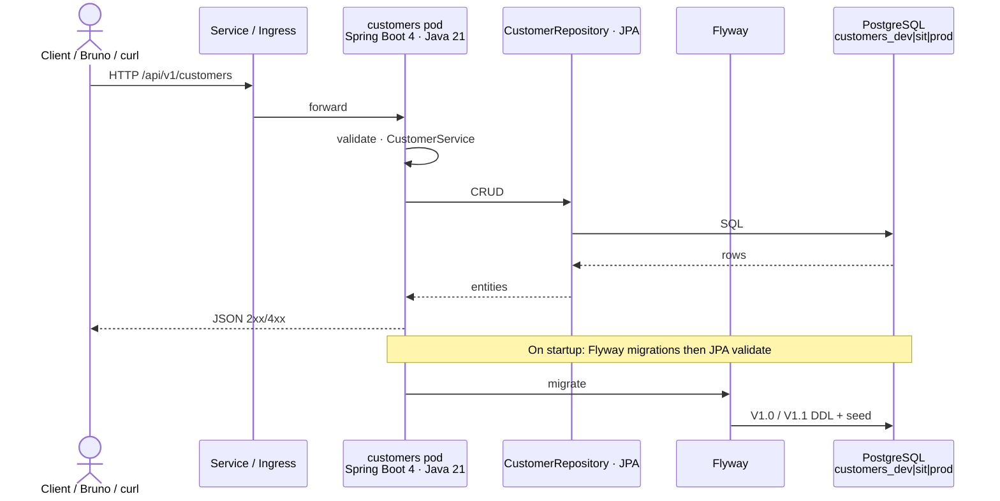
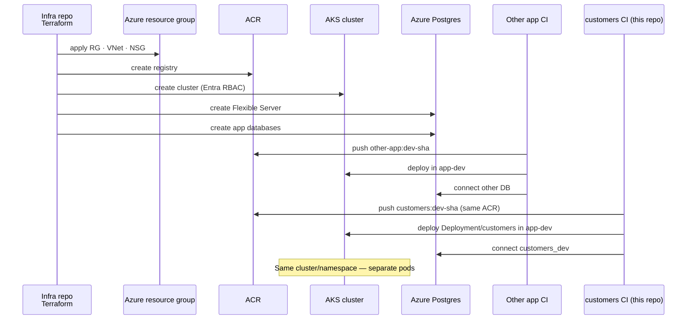
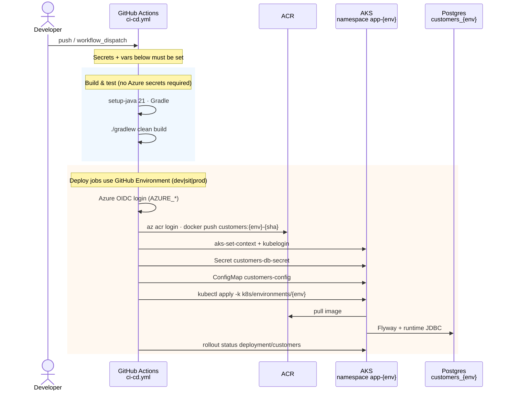
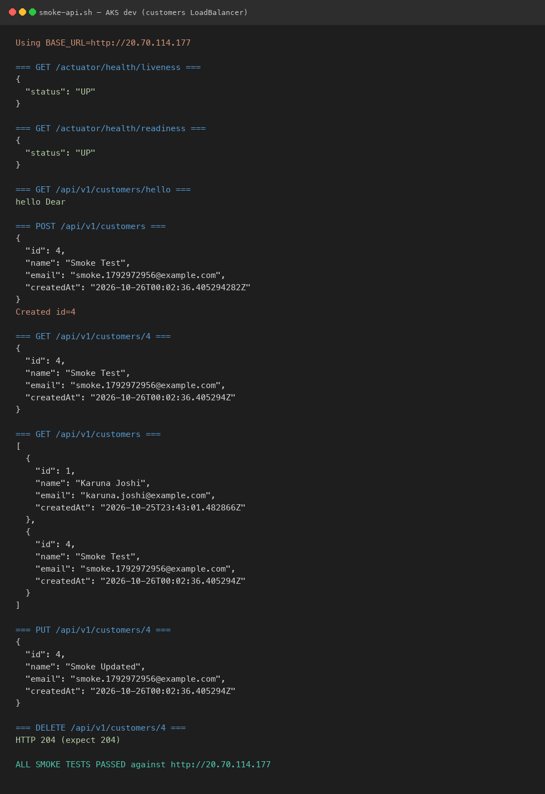
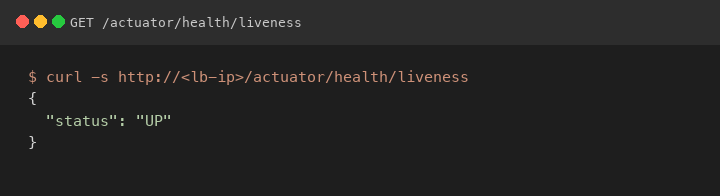
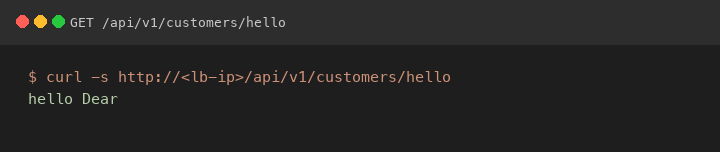
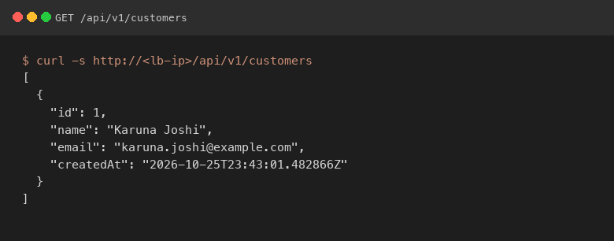
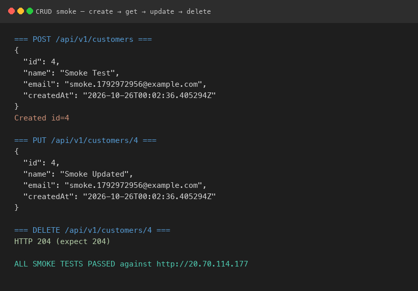

# Customers — Spring Boot Customer API (Gradle)

Spring Boot 4 / Java 21 REST API (JPA + Flyway + PostgreSQL). Packaged with **Docker** for **Azure Kubernetes Service (AKS)** and deployed via **GitHub Actions**.

Deploys as its own workload (`customers` image / Deployment) into a shared AKS cluster alongside other apps. Azure landing zone (AKS, ACR, VNet, PostgreSQL) comes from your infra repo (for example a Terraform stack).

| Workload | ACR image | Deployment | K8s namespace (dev) |
|----------|-----------|------------|---------------------|
| Companion app (optional) | `{acr}/<other-app>` | `<other-app>` | `app-dev` |
| **This repo** | `{acr}/customers` | `customers` | `app-dev` |

> Replace placeholders like `<your-acr>`, `rg-app-dev`, `aks-app-dev` with your team's real names. Examples below intentionally use **generic** names so this README is safe to share.

## Architecture (sequence diagrams)

### 1. App request path



### 2. Infra provision then apps on shared AKS



### 3. Build & deploy (this repo CI/CD)



## Local build, test, and run

Requires **JDK 21** and Docker (for Postgres / full stack).

```bash
# Optional: point JAVA_HOME at JDK 21 (Homebrew example)
# export JAVA_HOME="$(/usr/libexec/java_home -v 21 2>/dev/null || echo /opt/homebrew/opt/openjdk@21/libexec/openjdk.jdk/Contents/Home)"
# export PATH="$JAVA_HOME/bin:$PATH"
java -version   # expect 21.x
```

### Build

```bash
./gradlew clean build --no-daemon
# JAR: build/libs/customers-*.jar
```

### Test only

```bash
./gradlew test --no-daemon
# Reports: build/reports/tests/test/index.html
```

### Run app (Gradle + local Postgres)

```bash
docker compose up -d postgres
./gradlew bootRun --args='--spring.profiles.active=local'
# API: http://localhost:8080
curl -s http://localhost:8080/actuator/health/liveness
curl -s http://localhost:8080/api/v1/customers
```

### Run full stack (app + Postgres in Docker)

```bash
docker compose up --build
# API: http://localhost:8081  (host port mapped to container 8080)
curl -s http://localhost:8081/api/v1/customers
```

### Smoke test locally

```bash
./scripts/smoke-api.sh                              # Gradle on :8080
BASE_URL=http://localhost:8081 ./scripts/smoke-api.sh   # docker compose
```

## GitHub variables & secrets (build and deployment)

Create GitHub Environments named **`dev`**, **`sit`**, and **`prod`**. OIDC federated credentials must use subject:

`repo:<org>/<repo>:environment:<env>`

Use **customers**-specific DB credentials and JDBC URL so this pod does not share another app’s database.

### Repository secrets (OIDC — push image + deploy)

| Secret | Required for | Purpose |
|--------|--------------|---------|
| `AZURE_CLIENT_ID` | Push image + Deploy | App registration client ID |
| `AZURE_TENANT_ID` | Push image + Deploy | Azure AD tenant |
| `AZURE_SUBSCRIPTION_ID` | Push image + Deploy | Subscription GUID |

No ACR username/password — after OIDC login the workflow runs `az acr login`. Grant the SP **AcrPush** on the registry.

### Repository variables

| Variable | Required for | Example (generic) | Purpose |
|----------|--------------|-------------------|---------|
| `ACR_LOGIN_SERVER` | Push image | `<your-acr>.azurecr.io` | ACR hostname |
| `AKS_DEV_RESOURCE_GROUP` | Deploy → dev | `rg-app-dev` | AKS resource group |
| `AKS_DEV_CLUSTER_NAME` | Deploy → dev | `aks-app-dev` | AKS cluster name |
| `AKS_SIT_RESOURCE_GROUP` | Deploy → sit | `rg-app-sit` | |
| `AKS_SIT_CLUSTER_NAME` | Deploy → sit | `aks-app-sit` | |
| `AKS_PROD_RESOURCE_GROUP` | Deploy → prod | `rg-app-prod` | |
| `AKS_PROD_CLUSTER_NAME` | Deploy → prod | `aks-app-prod` | |

### Per-environment secrets (GitHub Environment `dev` / `sit` / `prod`)

| Secret | Required for | Purpose |
|--------|--------------|---------|
| `SPRING_DATASOURCE_USERNAME` | Deploy | Postgres user → `customers-db-secret` |
| `SPRING_DATASOURCE_PASSWORD` | Deploy | Postgres password → `customers-db-secret` |

### Per-environment variables (GitHub Environment `dev` / `sit` / `prod`)

| Variable | Required for | Example (generic) | Purpose |
|----------|--------------|-------------------|---------|
| `SPRING_DATASOURCE_URL` | Deploy | `jdbc:postgresql://<pg-server>.postgres.database.azure.com:5432/customers_dev?sslmode=require` | JDBC URL → `customers-config` |

Use the matching DB name per env: `customers_dev`, `customers_sit`, `customers_prod`.

### What the workflow injects into AKS

| K8s object | Keys |
|------------|------|
| Secret `customers-db-secret` | `SPRING_DATASOURCE_USERNAME`, `SPRING_DATASOURCE_PASSWORD` |
| ConfigMap `customers-config` | `SPRING_PROFILES_ACTIVE`, `APP_ENVIRONMENT`, `SERVER_PORT`, `SPRING_DATASOURCE_URL` |

### Build-only (pull requests)

PRs run **Build & Test** only (`./gradlew clean build`). They do **not** need Azure secrets or AKS/DB variables.

### Checklist before first deploy

1. Environments `dev` / `sit` / `prod` exist; OIDC subject matches each Environment.
2. Repo secrets `AZURE_CLIENT_ID` / `AZURE_TENANT_ID` / `AZURE_SUBSCRIPTION_ID` set.
3. Repo vars `ACR_LOGIN_SERVER` and `AKS_*_RESOURCE_GROUP` / `AKS_*_CLUSTER_NAME` set to **your** Azure names.
4. Per Environment: `SPRING_DATASOURCE_URL`, `SPRING_DATASOURCE_USERNAME`, `SPRING_DATASOURCE_PASSWORD`.
5. Databases `customers_dev` / `customers_sit` / `customers_prod` exist on your Azure Postgres Flexible Server.

## Spring profiles & environments

| Profile | Where it runs | Database |
|---------|---------------|----------|
| `local` | Developer laptop | Postgres via `docker-compose` (host port **5433**) |
| `dev` | AKS (dev) | Azure Postgres — `customers_dev` |
| `sit` | AKS (SIT) | Azure Postgres — `customers_sit` |
| `prod` | AKS (prod) | Azure Postgres — `customers_prod` |

## Project structure

```
src/main/java/com/example/demo/   # customer API
src/main/resources/               # profile YAML + Flyway migrations
k8s/
  base/                           # Deployment / Service / HPA (name: customers)
  environments/
    dev|sit|prod/
.github/workflows/ci-cd.yml
Dockerfile
docker-compose.yml
scripts/smoke-api.sh
bruno/customers-api/
```

## REST API

| Method | Path | Description |
|--------|------|-------------|
| `GET` | `/api/v1/customers` | List customers |
| `GET` | `/api/v1/customers/{id}` | Get one |
| `POST` | `/api/v1/customers` | Create |
| `PUT` | `/api/v1/customers/{id}` | Update |
| `DELETE` | `/api/v1/customers/{id}` | Delete |
| `GET` | `/actuator/health/liveness` | K8s liveness |
| `GET` | `/actuator/health/readiness` | K8s readiness |

## Deploy (manual)

```bash
kubectl apply -k k8s/environments/dev
kubectl -n app-dev get deploy,po -l app.kubernetes.io/name=customers
# LoadBalancer IP (dev):
kubectl -n app-dev get svc customers -o jsonpath='{.status.loadBalancer.ingress[0].ip}'
```

> If your cluster still uses another namespace name, set it in `k8s/environments/*/kustomization.yaml` / `namespace.yaml` to match, or override via your platform convention.

## Smoke tests

**1. Shell**

```bash
./scripts/smoke-api.sh
BASE_URL=http://localhost:8081 ./scripts/smoke-api.sh
BASE_URL=http://<lb-ip> ./scripts/smoke-api.sh
```

Get the AKS LoadBalancer IP:

```bash
kubectl -n app-dev get svc customers -o jsonpath='{.status.loadBalancer.ingress[0].ip}'
```

### Example run (AKS `app-dev`)

Full `./scripts/smoke-api.sh` against the customers LoadBalancer — health, hello, and CRUD all green:



| Check | Screenshot |
|-------|------------|
| Liveness `UP` |  |
| Hello |  |
| List customers |  |
| Create → update → delete |  |

**2. Bruno** — open `bruno/customers-api`, pick `local` or `aks-dev`, run the collection.

## GitHub Actions CI/CD

| Trigger | Environment |
|---------|-------------|
| Push to `develop` / `main` / `master` | `dev` |
| Push to `sit` | `sit` |
| `workflow_dispatch` | Choose `dev` / `sit` / `prod` |

Pipeline: build & test → push `customers:{env}-{sha}` to ACR → `kubectl apply -k k8s/environments/{env}`.
